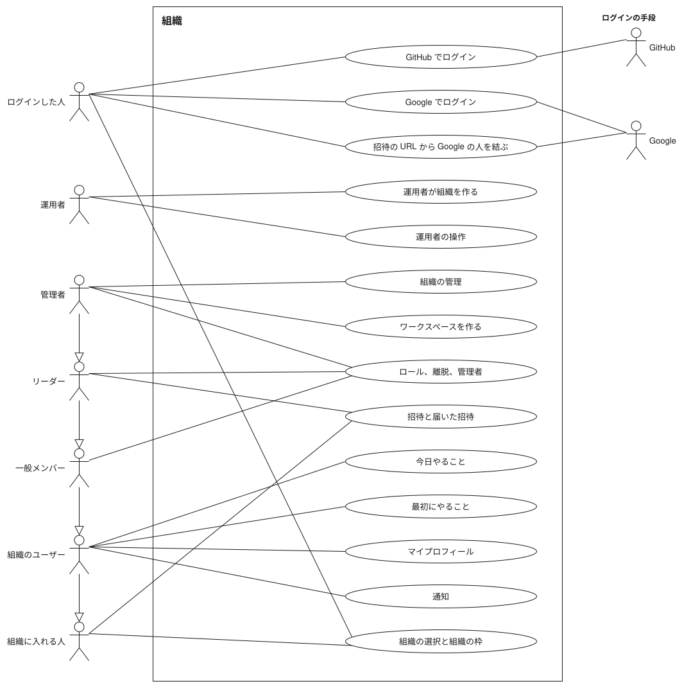
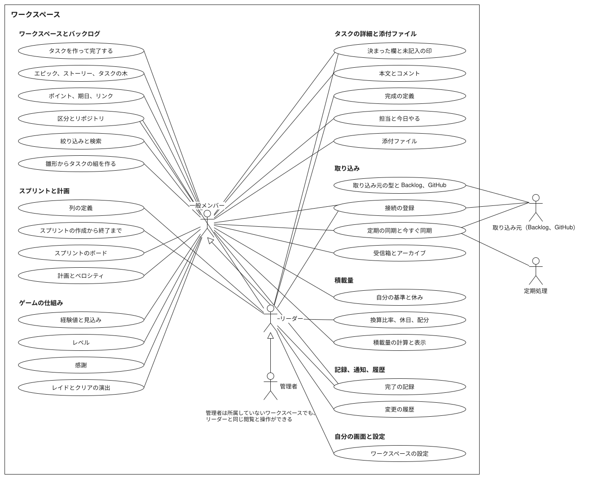

# ユースケース図

図は `docs/requirements.md`（「組織と運用者」「メンバーと権限」「取り込み」「ゲームの仕組み」「機能」の初版）と `.claude/skills/daily-scrum/page/features.json` の写しで、食い違えば文章が正とする。楕円の文字は `features.json` の機能の名前そのままとする。後回し、未決、Non-Goals、AI の機能は描かない。機能の一覧を変える PR は、同じ PR で図も直す。図は draw.io（デスクトップか app.diagrams.net）で開いて直し、同じ形式で書き出す。背景を白で塗り、ラベルは `html=0` にして SVG の文字（`foreignObject` でないもの）で書き出し、図のデータを埋め込む。デスクトップの CLI では `drawio -x -f svg -e -b 10 --theme light -o <名前>.drawio.svg <名前>.drawio` で書き出す（`--theme` を省くと見る側のテーマで色を入れ替える SVG になり、ダークのテーマで背景が黒くなる）。

## 組織の図

## ワークスペースの図

## アクター

| ロール | `permissionScopes` の名前 | 範囲 | できることの要約 |
| --- | --- | --- | --- |
| ログイン前の人 | `login` | outside | GitHub または Google でログインし、Google の招待を結ぶ |
| 運用者 | `operator` | outside | 組織を作り、組織の停止と再開、管理者の指名し直し、上限の変更を行う |
| 組織に入れる人 | `invitee` | organization | 組織を選び、届いた招待を承諾または辞退する |
| 組織のユーザー | `organization` | organization | 自分の今日、最初にやること、自分の設定、通知を使う |
| 管理者 | `admin` | organization | 組織を管理し、管理者とワークスペースを操作する |
| リーダー | `leader` | workspace | 一般メンバーの操作に加え、ワークスペースの定義と計画を操作する |
| 一般メンバー | `member` | workspace | タスク、スプリント、取り込み、ゲーム、積載量、記録を使う |
| ログインの手段（GitHub） | 副アクター | outside | GitHub でのログインで本人を確かめる |
| ログインの手段（Google） | 副アクター | outside | Google でのログインと、招待の URL からの結び付けで本人を確かめる |
| 取り込み元（Backlog、GitHub） | 副アクター | workspace | 接続を受け、取り込みと同期の相手になる |
| 定期処理 | 副アクター | workspace | 定期の同期を動かす |

汎化は 管理者 → リーダー → 一般メンバー → 組織のユーザー → 組織に入れる人 の順につなぎ、上のロールは下のロールのできることをすべてできる。線は、その機能を使えるロールのうち一番下のロールに引く。1つの機能の中で担い手が分かれるもの（招待するリーダーと承諾する組織に入れる人など）は、担い手ごとに線を引く。

## 図に描かない制約

本人、作った人、依頼主といった持ち主の制約はアクターにしない。操作の定義の `permission` は粗い門で、持ち主の判定はハンドラにある。たとえば、エピックをクリアできるのは依頼主とリーダー、削除できるのは作った人とリーダーである（`docs/requirements.md` の「メンバーと権限」）。自分の接続の登録と編集と削除は本人が行う。管理者が所属していないワークスペースで操作するときは、担当、討伐隊、経験値、積載量の対象から外れる。

API のトークンで呼ぶクライアント（`sg` を含む）は、発行した本人と同じ権限で操作を呼び、運用者の操作は呼べない。そのため、クライアントはアクターにせず、この注記にとどめる。

パスワードのログインと API トークンの発行は `docs/requirements.md` にあるが、`features.json` の機能の一覧に無いので楕円にしていない。雛形からタスクの組を作るは、雛形を誰が管理するかを #14 で決める途中なので、使う人（一般メンバー）にだけ線を引いた。
